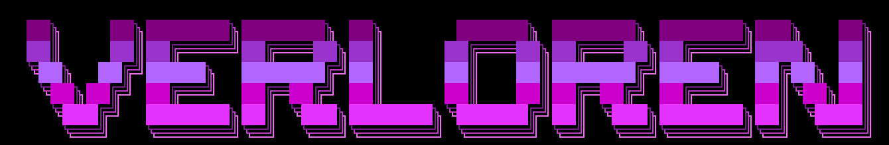

------------------------------------------------------------------------------------

 

### Languages and Technologies:
     

### Tools
            
 

### Socials:
  
  
<!--

-->

  
:zap: <b>GitHub stats</b>

  

   
     
    
   
  

